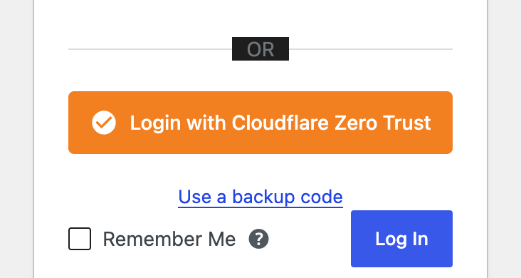

# Zero Trust Login for Cloudflare

Formerly *Cloudflare Zero Trust Login for WordPress*. The plugin was renamed in 2.1.0 for the
WordPress plugin directory; existing installs update in place.

[](https://github.com/cjscrofani/cloudflare-zero-trust-wordpress/releases/latest)
[](#-requirements)
[](#-requirements)
[](LICENSE)

Sign in to WordPress with your Cloudflare Zero Trust identity. The plugin turns a
Cloudflare Access SaaS application into a WordPress login over OpenID Connect, and can
create that application for you from inside wp-admin with one API token.

<p align="center">
  
</p>

**Why this plugin**

- **Set up in minutes.** Paste a scoped Cloudflare API token and the wizard discovers your
  account, creates the Access application with the right redirect URL and scopes, attaches
  an allow policy, and stores the credentials. The token is used once and never saved.
- **Cloudflare-only or side by side.** Primary mode makes Cloudflare the only way in:
  passwords never grant access and the reset and registration screens are refused. Secondary
  mode adds the Cloudflare button next to the normal form.
- **Users and roles follow your identity provider.** Accounts are created on first login
  with the email address as the username, identity-provider groups map to WordPress roles
  and are re-applied on every login, and email-domain restrictions are enforced every time.
- **Built for the failure cases.** Per-browser login state, a rate limiter that only trusts
  Cloudflare's own IP ranges, one-time backup codes for the day your identity provider is
  down, encrypted write-only secrets, and an audit log with CSV export.
- **Self-updating.** The GitHub package checks that repository for updates. The WordPress.org
  package updates through WordPress.org like any other directory plugin.

> **Upgrading from 1.x?** 2.0.0 removes SAML and changes how the client secret is stored.
> Read [Upgrading from 1.x](#%EF%B8%8F-upgrading-from-1x) first. If you are still on 1.0.4 or
> earlier, update to at least 1.0.5 today: those versions have a primary-mode bypass.

## 🚀 Features

### Authentication
- **OIDC Integration**: Seamless authentication using Cloudflare Zero Trust OpenID Connect
- **Automatic setup**: Provisions the Cloudflare Access application for you — no manual copying
- **Dual Application Support**: Works with both SaaS and Self-hosted Cloudflare applications
- **Flexible Login Modes**:
  - Secondary mode: Traditional WordPress login alongside Cloudflare login
  - Primary mode: Cloudflare-only authentication (WordPress passwords never grant access)
- **Backup codes**: Ten one-time emergency codes per Cloudflare-created account, usable in
  either login mode

### User Management
- **Automatic User Creation**: Optionally create WordPress users on first login
- **Role Assignment**: Configure a default role, or map Cloudflare groups to WordPress roles
- **Email Domain Restrictions**: Limit which email domains may log in, checked on every login
- **User Metadata**: Stores Cloudflare identity information securely

### Security
- **Encrypted Credentials**: Client secrets encrypted using AES-256-CBC (when OpenSSL available),
  never displayed in the admin and never included in settings exports
- **Environment Variables**: Support for storing credentials outside the database
- **Per-attempt OIDC state and nonce**: Each login mints its own state and nonce, bound to the
  browser with a short-lived HttpOnly cookie
- **Rate Limiting**: 10 failed attempts per IP per 5 minutes, with forwarding headers trusted
  only from Cloudflare's own edge
- **Security Headers**: Automatic security headers on login pages (CSP, X-Frame-Options, etc.)

### Administration
- **Dashboard and logs**: Authentication statistics, a filterable log viewer and CSV export
- **Settings import/export**: JSON export of everything except the client secret
- **Auto-Updates**: GitHub-based update system - no manual downloads needed
- **Hooks & Filters**: Extensible with WordPress actions and filters

## 📋 Requirements

- WordPress 5.0 or higher
- PHP 7.2 or higher
- A Cloudflare account with Zero Trust enabled
- SSL/HTTPS enabled on your WordPress site
- OpenSSL PHP extension (recommended for encryption)

## 🔧 Installation

### Method 1: WordPress plugin directory
Once the directory listing is approved, search for **Zero Trust Login for Cloudflare** under
Plugins → Add New. Updates then arrive through WordPress.org.

### Method 2: GitHub release
1. Download `zero-trust-login-for-cloudflare-<version>.zip` from the [Releases page](https://github.com/cjscrofani/cloudflare-zero-trust-wordpress/releases)
2. Upload it under Plugins → Add New → Upload Plugin, or unzip it into `/wp-content/plugins/`
3. Activate the plugin. This package checks GitHub for updates.

### Method 3: Git Clone
```bash
cd wp-content/plugins/
git clone https://github.com/cjscrofani/cloudflare-zero-trust-wordpress.git zero-trust-login-for-cloudflare
```

Pick one channel per site. The two packages are the same code, but a site should not have both
a GitHub-installed and a directory-installed copy.

## ⚙️ Configuration

### Automatic setup (recommended)

The plugin can create the Cloudflare application for you. Go to **Settings → CF Zero Trust**,
open the first wizard step, and use **Set this up for me**:

1. Click **Create a token on Cloudflare**. This opens the Cloudflare dashboard with the
   required permissions already selected. Click **Continue to summary**, then **Create Token**,
   and copy the token.
2. Paste the token into the wizard and click **Connect**.
3. Choose which Cloudflare account to use, name the application, and pick who should be
   allowed to log in (an email domain, a list of addresses, or anyone your identity provider
   authenticates). Use the domain your identity provider actually issues for logins — it may
   differ from your WordPress admin email's domain.
4. Click **Create application in Cloudflare**.

The plugin then reads your team domain, creates a SaaS OIDC application pointed at this
site's callback URL, attaches an Access policy named "WordPress login (your-host)", and saves
the credentials. The page reloads with the new settings. You can delete the API token in
Cloudflare immediately afterwards.

Once the plugin has created an application, the wizard shows a **Connected to Cloudflare**
summary instead of the token form. **Run automatic setup again** deletes that application in
Cloudflare and creates a fresh one with new credentials. If an application already points at
this site but was not created by the plugin, the wizard offers to replace it rather than
leaving an orphan behind.

Automatic setup is refused while `CFZT_CLIENT_ID` or `CFZT_CLIENT_SECRET` is defined in
`wp-config.php`: Cloudflare shows a new client secret exactly once, and the constants would
prevent it from ever being stored.

**Why a token rather than "log in with Cloudflare":** Cloudflare's OAuth requires every
redirect URL to be registered in advance and matched exactly, and a plugin installed on
arbitrary domains cannot pre-register them. Supporting a true one-click flow would mean
routing your credentials through a server this project would have to host and you would have
to trust. A token you create and revoke yourself keeps the plugin self-contained.

**About the token:**
- It is used only while setup runs and is **never written to your database**.
- The provisioned client secret is stored server-side and is never sent back to your browser.
- The token needs three account-level permissions:
  - `Account → Access: Apps and Policies → Edit`
  - `Account → Access: Organizations, Identity Providers, and Groups → Read`
  - `Account → Account Settings → Read` (without it Cloudflare returns an empty account list)

If your Cloudflare account has no Zero Trust organization yet, create one (choose a team
domain) in the [Zero Trust dashboard](https://one.dash.cloudflare.com/) first.

### Manual setup

Prefer to do it by hand, or automatic setup did not fit your environment? The steps below
still work, and the wizard keeps them available under **Or set it up manually**.

### Step 1: Cloudflare Zero Trust Setup

1. Log in to your [Cloudflare Zero Trust dashboard](https://one.dash.cloudflare.com/)
2. Navigate to **Access** → **Applications**
3. Click **Add an application**
4. Choose application type:
   - **SaaS** (Recommended): For standard OIDC integration
   - **Self-hosted**: For custom applications
5. Configure the application:
   - **Application name**: Your WordPress site name
   - **Session duration**: As desired
   - **Application domain**: Your WordPress URL
6. Configure OIDC settings:
   - **Redirect URL**: `https://yoursite.com/wp-login.php?cfzt_callback=1`
   - **Grant type**: Authorization code
   - **Scopes**: openid, email, profile, groups (`groups` is what role mapping reads)
7. Save and note your:
   - Client ID
   - Client Secret
   - Team Domain (from Issuer URL, e.g., `yourteam.cloudflareaccess.com`)

### Step 2: WordPress Plugin Configuration

1. Go to **Settings** → **CF Zero Trust** in WordPress admin
2. Enter your Cloudflare credentials:
   - **Team Domain**: Your Cloudflare team domain
   - **Client ID**: From Cloudflare application
   - **Client Secret**: From Cloudflare application. Once saved it is never shown again;
     leave the field blank on later saves to keep the stored secret, or type a new one to
     replace it.
3. Configure options:
   - **Application Type**: Match what you created in Cloudflare
   - **Login Mode**: Secondary (both) or Primary (Cloudflare only)
   - **Auto-create Users**: Enable to create users on first login
   - **Default Role**: Role for new users
4. Save settings

### Step 3: Security Hardening (Recommended)

Add to your `wp-config.php`:

```php
// Method 1: Direct constants
define('CFZT_CLIENT_ID', 'your-client-id-here');
define('CFZT_CLIENT_SECRET', 'your-client-secret-here');

// Method 2: Environment variables
define('CFZT_CLIENT_ID', getenv('CFZT_CLIENT_ID'));
define('CFZT_CLIENT_SECRET', getenv('CFZT_CLIENT_SECRET'));
```

Or use `.env` file:
```
CFZT_CLIENT_ID=your-client-id-here
CFZT_CLIENT_SECRET=your-client-secret-here
```

### Login modes

**Secondary** (default) shows the Cloudflare button above the normal WordPress form. Both
work.

**Primary** makes Cloudflare the only way in. Visiting `wp-login.php` redirects straight to
Cloudflare, a submitted password is never accepted regardless of whether it is correct, and
the lost-password, password-reset and registration screens are refused server-side (the list
is filterable via `cfzt_primary_mode_blocked_actions`). Non-interactive contexts — REST,
XML-RPC, WP-CLI, cron and admin-ajax — are left alone.

The one interactive exception is a **backup code**. The "Use a backup code" link stays on the
login page in both modes, so an account the plugin created can still get in if Cloudflare is
unreachable. Switch to primary mode only after you have generated backup codes for at least
one administrator, or have `wp-config.php` access to switch the mode back.

### Automatic user creation

With **Auto-create Users** enabled, the first Cloudflare login for an unknown email address
creates a WordPress account:

- The username is the full email address, lower-cased (for example `jane@example.com`), so
  people from different domains cannot collide. Change it with the `cfzt_new_username` filter.
  A numeric suffix is still appended in the unlikely event of an exact duplicate.
- The role comes from role mapping if a Cloudflare group matches, otherwise the default role.
- The account is tagged with the `cfzt_user` user meta, which is what makes it eligible for
  backup codes and for role re-sync.

Role mapping is re-applied on every login for plugin-created accounts whenever Cloudflare sends
a group claim (disable with `cfzt_sync_role_on_login`). Accounts you created by hand keep
whatever role you gave them. Email domain restrictions are checked on every Cloudflare login,
not only when an account is created.

### Backup codes

Codes are generated from the user's profile page: your own under **Profile**, or someone
else's under **Users → Edit** if you can edit that user. They are available only for accounts
the plugin created, require the `edit_user` capability for that specific user, are shown once, stored as bcrypt hashes, and each works exactly once. On the
login page, click **Use a backup code**, enter the username or email and one code. Failed
attempts count towards the rate limit.

## 🎯 Usage

### For End Users

1. Navigate to your WordPress login page
2. Click "Login with Cloudflare Zero Trust"
3. Authenticate with your Cloudflare identity provider
4. You'll be redirected back and logged into WordPress (a `redirect_to` on the login URL is
   honoured unless a post-login redirect is configured in settings)

### For Administrators

- **Monitor Authentication**: Enable logging to track login attempts (Tools → CF Zero Trust)
- **User Management**: View Cloudflare-authenticated users via user meta `cfzt_user`
- **Access Control**: Use Cloudflare policies to control who can access your site

## 🔐 Security Considerations

- **Always use HTTPS** for your WordPress site
- **Keep WordPress salts configured** properly in `wp-config.php` (affects encryption; rotating
  the salts invalidates the stored client secret, so re-enter it afterwards)
- **Use environment variables** for credentials when possible (see Step 3 in Configuration)
- **The client secret is write-only**: it is never rendered into the settings page and never
  included in a settings export. Keep a copy somewhere safe, or be ready to generate a new one
  in Cloudflare.
- **Regularly update the plugin** for security patches via the built-in GitHub updater
- **Monitor authentication logs** for suspicious activity (enable in settings)
- **Implement IP restrictions** in Cloudflare Zero Trust policies for additional security
- **Use strong authentication** in your Cloudflare identity provider (MFA recommended)
- **Behind a proxy that is not Cloudflare?** The rate limiter ignores `X-Forwarded-For` and
  friends unless the connecting address is a trusted proxy. Add your load balancer's ranges with
  the `cfzt_trusted_proxies` filter, otherwise every visitor shares one counter.

## 🔒 A note on SAML

Versions before 2.0.0 shipped an experimental SAML implementation that did not verify
response signatures, leaving it open to tampering and replay. **It was removed in 2.0.0
rather than left in place behind a warning.**

Nothing is lost by this: a Cloudflare Access SaaS application terminates at the same place
whether you reach it over OIDC or SAML, so OIDC — which is fully implemented and verified —
covers every case this plugin supports. Sites that were configured for SAML are migrated to
OIDC automatically on upgrade, and are moved off "Cloudflare only" login mode so they cannot
be locked out mid-migration. See [Upgrading from 1.x](#-upgrading-from-1x).

If you genuinely need SAML as a protocol, use a maintained library such as SimpleSAMLphp,
LightSAML or OneLogin PHP SAML rather than rolling it into a login plugin.

## ⬆️ Upgrading from 1.x

- **SAML is gone.** A site configured for SAML is switched to OIDC on the first request after
  the update, its `saml_*` settings are dropped, and a persistent notice explains what
  happened. Follow the setup wizard to connect an OIDC application.
- **Login mode may change.** A SAML site that was in "Cloudflare only" mode is moved to
  "alongside WordPress login" so nobody is locked out while it is reconfigured. Switch back
  once OIDC works.
- **Role mapping now works.** 1.x never requested the `groups` scope, so mappings never
  matched. If you configured mappings in 1.x, expect plugin-created accounts to pick up their
  mapped roles at their next login.
- **Settings imports no longer carry the client secret.** After importing a 2.0.0 export, enter
  the secret by hand. Imports from 1.x exports still restore it.
- **New accounts get email-address usernames.** Existing accounts are untouched.
- **Backup codes work in primary mode** and require `edit_user` on the target rather than the
  blanket `edit_users` capability.
- Stored secrets are re-encoded with a marker on upgrade; nothing to do unless the salts have
  changed since the secret was saved, in which case re-enter it.

## 🛠️ Development

### Local development

A ready-made WordPress test environment lives in `.dev/`:

```bash
.dev/bin/dev up
```

That starts WordPress over HTTPS with the plugin bind-mounted, so host edits are live.
See [`.dev/README.md`](.dev/README.md) for the full command list, including
`.dev/bin/dev seed-saml`, which reproduces a pre-2.0.0 SAML install to exercise the
upgrade migration.

### Release

```bash
.dev/bin/build-release                # GitHub asset from HEAD (or: ... v2.1.0)
.dev/bin/build-release --wporg        # WordPress.org package: same, minus the updater
.dev/bin/build-release --worktree     # package the uncommitted working tree, for testing
```

Both commands run `git archive` with the `zero-trust-login-for-cloudflare/` prefix and exclude
everything marked `export-ignore` in `.gitattributes` (`.dev/`, `.wordpress-org/`, Markdown,
dotfiles). The script refuses to build if `readme.txt`'s `Stable tag` disagrees with the
plugin header.

- `dist/zero-trust-login-for-cloudflare-<version>.zip` goes on the GitHub release. The
  in-plugin updater prefers a `.zip` asset over the tag zipball and renames the extracted
  folder to whatever the site already has, so installs under the old
  `cloudflare-zero-trust-login` folder keep updating. Tags are `vX.Y.Z`.
- `dist/zero-trust-login-for-cloudflare-<version>-wporg.zip` is what gets submitted to
  WordPress.org and, after approval, committed to SVN `trunk/` and `tags/<version>/`. It must
  not contain `class-github-updater.php` (directory guideline 8). The listing artwork lives in
  `.wordpress-org/` and goes into the SVN `assets/` directory, not the plugin.

### Project Structure
```
zero-trust-login-for-cloudflare/        (GitHub installs made before 2.1.0 keep the old folder name)
├── assets/
│   ├── css/
│   │   └── cfzt-login.css
│   └── js/
│       └── cfzt-admin.js
├── includes/
│   ├── class-cfzt-admin.php            # Settings page, AJAX, import/export
│   ├── class-cfzt-auth.php             # OIDC flow, primary-mode enforcement
│   ├── class-cfzt-backup-codes.php
│   ├── class-cfzt-cloudflare-api.php   # Cloudflare API v4 client
│   ├── class-cfzt-logger.php
│   ├── class-cfzt-login-ui.php
│   ├── class-cfzt-plugin.php           # Bootstrap, migrations, save_settings()
│   ├── class-cfzt-provisioner.php      # Creates the Access application
│   ├── class-cfzt-security.php         # Encryption, rate limiting, headers
│   ├── class-cfzt-setup.php            # Guided setup AJAX endpoints
│   ├── class-cfzt-user-helper.php      # User creation, role mapping, domain rules
│   └── class-github-updater.php
├── templates/
│   ├── admin-page.php
│   ├── dashboard-page.php
│   ├── login-button.php
│   └── logs-page.php
├── cloudflare-zero-trust-login.php
└── uninstall.php
```

### Hooks and Filters

#### Actions
- `cfzt_user_authenticated( WP_User $user, array $user_info )` - After a successful Cloudflare login
- `cfzt_user_created( WP_User $user, array $user_info )` - After the plugin creates an account
- `cfzt_authentication_attempt( string $identifier, bool $success, string $auth_method, string $reason )` - On every logged attempt

#### Filters
- `cfzt_new_username( string $username, string $email, array $user_info )` - Username for a new account (default: the email address)
- `cfzt_sync_role_on_login( bool $sync, WP_User $user, array $user_info )` - Re-apply role mapping on login (default `true`)
- `cfzt_primary_mode_blocked_actions( array $actions )` - `wp-login.php` actions refused in primary mode
- `cfzt_trusted_proxies( array $cidrs, string $remote_addr )` - Extra CIDR ranges whose forwarding headers are believed (Cloudflare's are always included)
- `cfzt_log_retention_rows( int $rows )` - Log rows kept before pruning (default 10000, minimum 100)
- `cfzt_redirect_uri( string $uri )` - The OIDC callback URL (must match the Cloudflare application exactly)
- `cfzt_provision_app_body( array $body, string $account_id )` - The Access application payload before it is created
- `cfzt_token_permission_keys( array $keys )` - Permission groups requested by the token setup link

#### Writing settings from code

`update_option('cfzt_settings', ...)` runs the form sanitizer, which expects plaintext from an
admin. Use `CFZT_Plugin::save_settings( array $options )` for programmatic writes; it bypasses
the sanitizer and clears the options cache. Encrypted values carry a `cfzt-enc:v1:` marker,
so `CFZT_Security::encrypt_data()` never wraps a value twice.

## 🐛 Troubleshooting

### Common Issues

**Login button not appearing**
- Verify Team Domain and Client ID are configured
- Check browser console for JavaScript errors

**"Invalid Authentication Request"**
- The login must finish within 10 minutes in the same browser it started in
- Make sure the browser accepts cookies from your site

**Authentication fails**
- Ensure redirect URL matches exactly in Cloudflare
- Verify Client Secret is correct (re-enter it; it is never displayed)
- Check WordPress error logs with logging enabled

**Users cannot be created**
- Enable "Auto-create Users" in settings
- Verify default role is valid
- Check user email isn't already registered
- Check Email Domain Restrictions include the domain your identity provider issues

**Rate limit errors**
- Wait 5 minutes before trying again
- Check for automated/bot login attempts
- Behind a non-Cloudflare proxy, add its ranges via `cfzt_trusted_proxies`

### Debug Mode

Add to `wp-config.php`:
```php
define('WP_DEBUG', true);
define('WP_DEBUG_LOG', true);
define('WP_DEBUG_DISPLAY', false);
```

Then enable authentication logging in plugin settings.

## 📄 License

GPL-2.0-or-later. See [LICENSE](LICENSE).

## 🔗 Links

- [Plugin Website](https://github.com/cjscrofani/cloudflare-zero-trust-wordpress)
- [Report Issues](https://github.com/cjscrofani/cloudflare-zero-trust-wordpress/issues)
- [Security Policy](SECURITY.md)
- [Cloudflare Zero Trust Documentation](https://developers.cloudflare.com/cloudflare-one/)
- [WordPress Plugin Handbook](https://developer.wordpress.org/plugins/)
